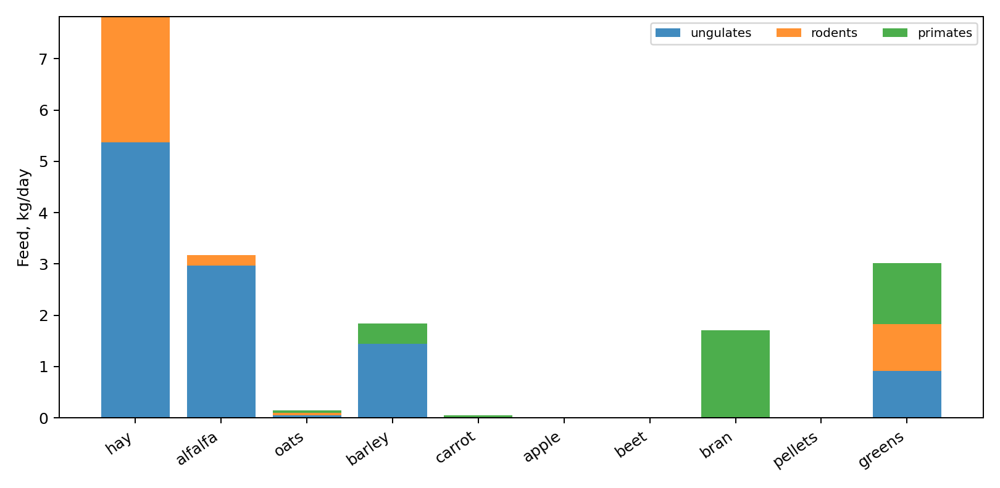

# Лабораторная работа № 1 — Рацион кормления животных

**Дисциплина:** Методы оптимизации  
**Автор:** Мандрыка Арина Юрьевна, Б24-507  
**Вариант:** 16 · **Seed:** `10017` · **Год:** 2026

**Полученный оптимум:** 38,104 руб/сут; дефицитный сценарий — 38,987 руб/сут; стрессовый — 47,874 руб/сут.



## Задача

Найти минимальную суточную стоимость кормления трёх групп животных при выполнении пяти норм питательных веществ, ограничениях доступного запаса десяти кормов, запретах отдельных кормов и верхних нормах энергетической ценности. Переменные `x[a,f]` — непрерывные килограммы корма `f` для группы животных `a` за сутки.

**Метод:** линейное программирование, двойственный симплекс HiGHS (`scipy.optimize.linprog(method="highs-ds")`), presolve. Исходные данные учебные и не являются ветеринарными нормами.

## Быстрый старт

Python 3.12+; из корня проекта:

```bash
python -m pip install -r requirements.txt
python main.py
python -m unittest discover -s tests -v
```

Для повторной генерации идентичного набора входных данных:

```bash
python generate.py
python main.py
```

## Сценарии

| Сценарий | Изменение |
| --- | --- |
| `base` | Исходные нормы и доступные запасы |
| `shortage` | Запас сена уменьшен на 20% |
| `stress` | Запас сена и гранулированного корма −20%, нормы нутриентов +20% |

Для каждого допустимого решения рассчитываются все остатки ограничений **отдельной проверкой на NumPy**, пересчитывается стоимость и формируется таблица порций. Для активных ограничений сохраняются теневые цены; отдельно проверяется прогноз малым увеличением ресурса.

## Состав проекта

| Файл / каталог | Назначение |
| --- | --- |
| `generate.py` | Детерминированная генерация варианта |
| `data/instance.json` | Коэффициенты, запасы, нормы, разрешённость кормов |
| `model.py` | Построение матриц ограничений и вызов HiGHS |
| `verify.py` | Независимая проверка всех ограничений и стоимости |
| `main.py` | Запуск сценариев, запись CSV, JSON, графиков, протокола |
| `tests/` | Автоматические проверки, включая отрицательный тест |
| `results/` | Реальные результаты расчётов и протокол решателя |
| `report.pdf`, `report.docx` | Отчёт с постановкой, формулами и выводами |

Важные файлы результатов: `results/scenarios.csv`, `results/solution_base.csv`, `results/shadow_prices.csv`, `results/validation_base.json`, `results/ration.png`, `results/solver_log.txt`.

## Точность и воспроизводимость

Данные сохраняются отдельно от модели. Допустимость проверяется с абсолютным допуском **1e-7**; целевая функция независимо пересчитывается. Версии библиотек зафиксированы в `requirements.txt`. Отчёт содержит интерпретацию оптимального решения и ограничения его практического использования.
